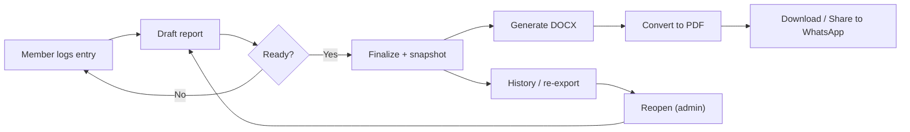
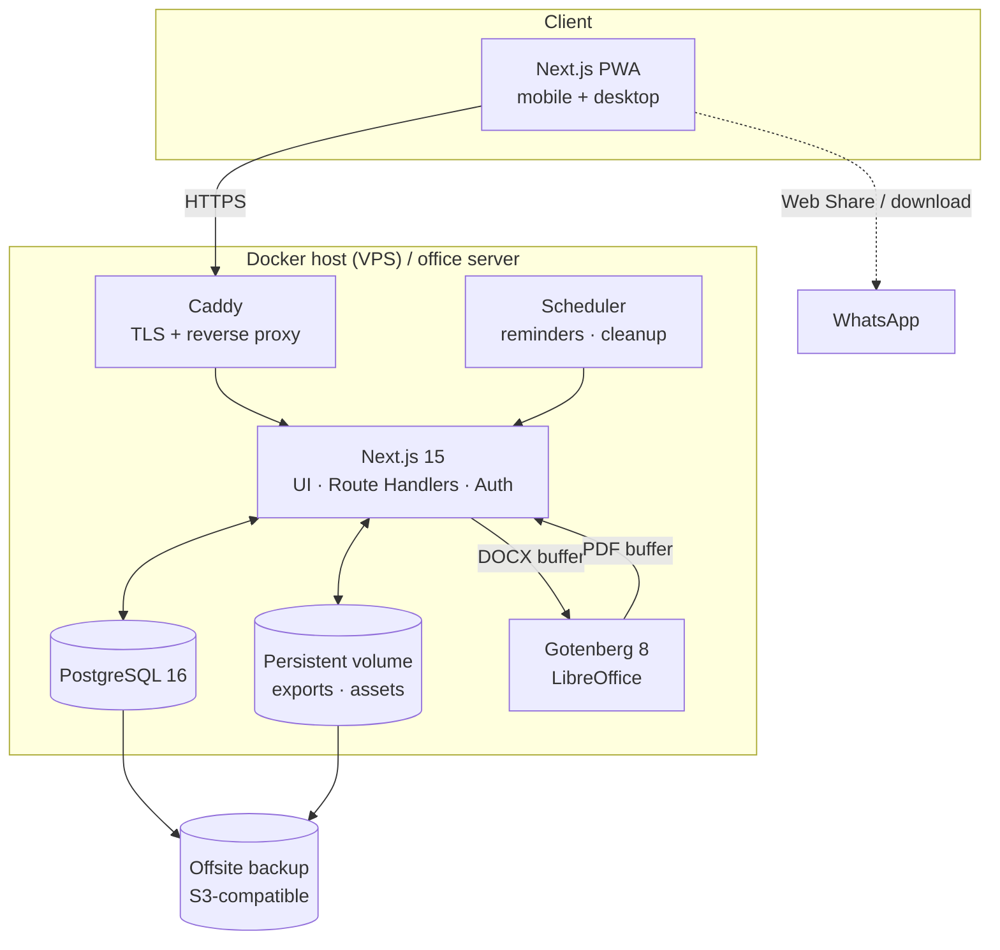
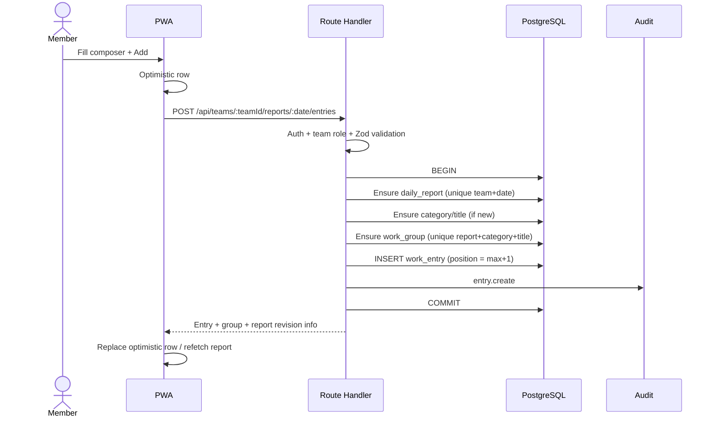
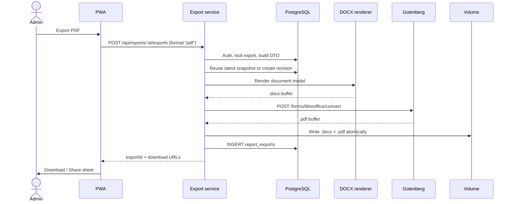
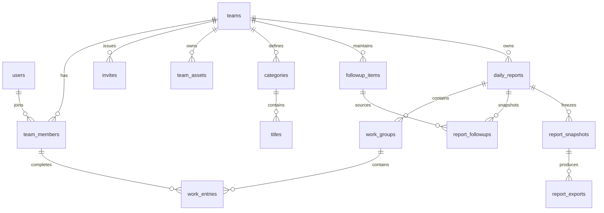

# CGHQ Team Work Report — System Architecture

| | |
|---|---|
| **Version** | 1.0 (proposed) |
| **Date** | 14 November 2026 |
| **Working name** | CGHQ Team Work Report |
| **Reference spec** | [EXPORT-SPEC.md](EXPORT-SPEC.md) |
| **Status** | Architecture approved for build planning; open questions in § 20 |

---

## Contents

1. [Executive summary](#1-executive-summary)
2. [Context and discovery](#2-context-and-discovery)
3. [Goals and non-goals](#3-goals-and-non-goals)
4. [Users and roles](#4-users-and-roles)
5. [Core workflows](#5-core-workflows)
6. [Functional requirements](#6-functional-requirements)
7. [System architecture](#7-system-architecture)
8. [Data architecture](#8-data-architecture)
9. [Export architecture](#9-export-architecture)
10. [API design](#10-api-design)
11. [Frontend architecture and UX](#11-frontend-architecture-and-ux)
12. [Security and privacy](#12-security-and-privacy)
13. [Operations and deployment](#13-operations-and-deployment)
14. [Testing and quality](#14-testing-and-quality)
15. [Delivery plan](#15-delivery-plan)
16. [Risks and mitigations](#16-risks-and-mitigations)
17. [Alternatives considered](#17-alternatives-considered)
18. [Architecture decisions](#18-architecture-decisions)
19. [Future roadmap](#19-future-roadmap)
20. [Open questions and assumptions](#20-open-questions-and-assumptions)
21. [Glossary](#21-glossary)

---

## 1. Executive summary

The team needs the same thing every day: a clean, correctly formatted daily report, assembled from what each member did, exported as DOCX and PDF, and sent to WhatsApp. Today that is done by hand in a shared Google Doc, including manual cell merges and numbering.

This design replaces that routine with a small, private web app:

- **Members** log tasks in a mobile-first PWA. Each task has a category, a title (the workstream), the status text, and the member who completed it.
- **The app** groups tasks by category + title, assigns serial numbers, merges the first three columns in the exported document, and numbers the status rows exactly like the sample.
- **Follow-up items** live in a persistent list and are copied into each day's report, so yesterday's report never changes when today's follow-ups are updated.
- **Export** is DOCX-first: one deterministic document model is rendered to DOCX, then converted to PDF by LibreOffice (Gotenberg). This guarantees the two files match.
- **Every export is a frozen snapshot.** Old reports can always be re-downloaded exactly as they were sent, even if names, categories, or follow-up text change later.
- **WhatsApp sharing** uses the native share sheet (files) on mobile, with a download + WhatsApp Web fallback on desktop.

The recommended deployment is a single small VPS running Docker Compose: Next.js, PostgreSQL, Gotenberg, and Caddy. It is inexpensive, private, and has no serverless timeout or filesystem limitations. A managed-cloud variant is documented for teams that prefer zero server maintenance.

**MVP scope:** one team, 2–10 members, daily reports, categories/titles, follow-ups, DOCX/PDF export, history, mobile sharing. **Target:** 2–3 weeks for MVP, about 4 weeks to production-ready.

---

## 2. Context and discovery

### 2.1 Current workflow

1. A shared Google Doc is open all day.
2. Members add rows or append to the **Status** column.
3. Someone manually groups rows, merges **Ser / Report Category / Title** cells, and numbers the status lines.
4. A separate **Follow-up Items** table is maintained below the main table.
5. At the end of the day the doc is downloaded, converted to PDF, and sent to a WhatsApp group.
6. The file is named like `Team_Work_Status_12_November_2026.pdf`.

### 2.2 What the supplied files tell us

The supplied DOCX and PDF were inspected directly. The PDF is **3 pages**, landscape, and has a repeating header. The DOCX was unzipped and its OOXML measured. Key facts:

- Page: **Letter landscape**, 11 × 8.5 in (15840 × 12240 twips).
- Header on **every page**: logo (1.33 × 0.74 in), then **CGHQ Daily Report** centered in bold Times New Roman 15 pt.
- Body font: **Times New Roman 14 pt**.
- **Date:** `12 November 2026`, with a bold `Date:` label.
- Main table: 5 columns — **Ser, Report Category, Title, Status, Task Completed By** — width 14445 twips, with visible 0.875 pt black borders.
- The first three columns are **vertically merged** for each category/title group.
- Each status line is a **separate table row**, numbered continuously within the group in the sample (`1.`–`13.`).
- Follow-up table: same five columns but no vertical merges; a bold, underlined **Follow-up Items:** heading.
- **Prepared By:** bold label followed by the preparer's name.
- No footer, no page numbers.

The full measurement and rendering specification is in [EXPORT-SPEC.md](EXPORT-SPEC.md). Reference assets are in `docs/reference/`.

### 2.3 Pain points

| Pain | Consequence |
|---|---|
| Manual row grouping and cell merging | Formatting mistakes, time lost |
| Manual numbering | Numbers drift when rows are inserted |
| Shared doc editing | Accidental changes, no clear ownership |
| Download → PDF conversion | Extra manual steps, wrong page setup |
| Follow-ups rewritten daily | Past reports mutate; "As Previous" is ambiguous |
| No structured data | Cannot count work per member or search history |
| No audit trail | Cannot tell who changed what |

### 2.4 Constraints

- The final document format is **fixed**; this is not a redesign exercise.
- The team is small (2–4 people today), but the design should allow up to ~10 without rework.
- Members may log from phones; the export may happen on desktop or phone.
- The document is internal; confidentiality and access control matter.
- The workflow must remain fast at end of day.

---

## 3. Goals and non-goals

### 3.1 Goals

| Goal | Success measure |
|---|---|
| Replace manual formatting | A generated DOCX/PDF passes a visual QA against the sample with no edits |
| Fast daily entry | A member can add a task in ≤ 20 seconds after typing, with ≤ 4 interactions |
| One shared daily report | Every member sees the same live draft; changes appear within 30 seconds |
| Reliable export | P95 export time ≤ 10 seconds; both formats generated from the same snapshot |
| Historical fidelity | Any past day can be re-exported exactly as originally sent |
| Follow-ups without history loss | Yesterday's report content never changes when today's follow-ups change |
| Private by default | Invite-only accounts; no cross-team data access; HTTPS everywhere |
| Low operating burden | One-command deploy, nightly backups, health checks |

### 3.2 Non-goals (v1)

- Project management, ticketing, time tracking, or attendance.
- Real-time co-editing like Google Docs (live refresh is enough).
- Automated posting into WhatsApp **groups** via the official API (see § 9.6).
- Replacing Google Docs for any other document type.
- Payroll, leave management, or HR workflows.
- Public sign-up or public report links.
- Native iOS/Android apps (PWA first).
- Rich text formatting inside status cells (plain text + line breaks only).

### 3.3 Principles

1. **The report is the product.** The UI exists to produce a perfect document quickly.
2. **Freeze what you send.** Exports are immutable snapshots.
3. **One rendering source of truth.** DOCX is the master; PDF is a conversion, not a second template.
4. **Structured data, derived layout.** Ser numbers and merges are computed, never typed.
5. **Mobile-first, desktop-friendly.** Entry on a phone; review/export on either.
6. **Boring, proven technology.** Small team, long life, easy handover.

---

## 4. Users and roles

| Role | Typical person | Capabilities |
|---|---|---|
| **Owner** | Team founder / lead | Everything an admin can do, plus delete/transfer team, manage billing/ownership |
| **Admin** | Team lead / report preparer | Manage members, categories/titles, branding, finalize/reopen, export, edit any entry |
| **Member** | Team member | Add/edit/delete own entries while draft, view report, export if allowed, manage own profile |
| **Viewer** *(optional)* | Manager / auditor | Read and export only; no edits |

Default permissions:

- Only the **owner/admin** can finalize or reopen a report.
- Members can export if `teams.members_can_export = true` (default **true**, because the team may rotate who sends the report).
- Members can edit only their own entries while the report is a draft.
- Admins can edit any entry while draft.
- Removing a member **deactivates** them; historical names and entries are preserved.
- A team always has at least one owner.

The full permission matrix is in [§ 12.2](#122-permission-matrix).

---

## 5. Core workflows

### 5.1 First-time setup (admin)

1. Create the team (name, timezone, document title, file prefix).
2. Upload a logo (default: the extracted `logo-solution-art.png`).
3. Invite members by one-time link or add them directly.
4. Review seeded categories/titles (from the sample) and adjust.
5. Add the initial follow-up items.
6. Set the default "Prepared By" name.

### 5.2 Daily logging (member)

1. Open the PWA (installed on the home screen or in the browser).
2. Today's report opens by default.
3. Tap **Add work**.
4. Choose **Category** and **Title** (or create a new one inline).
5. Type what was done.
6. Confirm **Completed by** — defaults to the current member.
7. Tap **Add** (or **Add & another** to keep the same group).
8. The entry appears immediately in the grouped preview.

### 5.3 Review and adjust (lead)

1. Open the day's report.
2. See member counts and the grouped document preview.
3. Reorder groups or entries if needed (drag handles).
4. Edit any entry (admin) or ask the author to fix it.
5. Confirm the **Prepared By** name.

### 5.4 Follow-ups (any member/admin)

1. Open **Follow-ups**.
2. Add a persistent item (category, title, current status, "As Previous" or a member).
3. Each new day, active items are copied into that day's follow-up table.
4. Editing today's follow-up updates the master item and today's copy; previous days remain frozen.
5. Items can be hidden for a day without deleting them.

### 5.5 Finalize and export (admin/lead)

1. Tap **Finalize** → the report locks and a revision snapshot is stored.
2. Tap **PDF** and/or **DOCX**.
3. The server builds the document, converts it to PDF, stores both files, and returns download links.
4. On mobile, tap **Share** → the native share sheet → WhatsApp.
5. On desktop, download the file and attach it in WhatsApp Web (or use the OS share sheet).

### 5.6 Reopen / amend (admin)

1. Open a finalized report → **Reopen** (reason required).
2. Edit and finalize again → revision 2 snapshot.
3. Old exports remain downloadable; new exports use the latest revision.

### 5.7 History

- List by date, with status (draft/finalized), member counts, and last export.
- Filter by member or category.
- Re-download or re-share any past report.



### 5.8 Daily report lifecycle (date rollover)

The date is what makes one day's document different from the next. It is a first-class field, not a label someone types by hand.

| Moment | What happens |
|---|---|
| App opened | The dashboard resolves "today" in the team timezone (`Asia/Dhaka` by default) and calls `GET /api/teams/:teamId/reports/:date`. That endpoint is **get-or-create**, so a new calendar date yields a new draft report with no manual step. |
| Previous day | Becomes history automatically. Once finalized it is read-only, and its exports are frozen. Nothing carries over except follow-up items. |
| Work entries | **Not** copied between days. Each day starts with an empty main table; members add that day's work. |
| Follow-ups | Active master items are copied into the new day's snapshot rows (`report_followups`) with `As Previous` as the default completed-by label. |
| Document date line | Rendered from `report_date` as `D MMMM YYYY` (e.g. `14 November 2026`) — never from the server clock at render time. |
| File name | Derived from the same `report_date`: `CGHQ_Team_Work_Status_14_November_2026.pdf`. |
| Re-export later | Re-exporting 12 November 2026 still produces `..._12_November_2026.pdf` weeks later. The date follows the **report**, not the export time. |

Guarantees:

- `UNIQUE (team_id, report_date)` means exactly one document per team per day (§ 8.6).
- "Today" is computed once, server-side, from the team's timezone. A device with a wrong clock cannot create a report for the wrong date.
- Two members submitting near midnight get either the same day's report or two consecutive days' reports — never a duplicate.
- The stored column is a PostgreSQL `date`, so timezone or daylight-saving drift cannot shift it.
- Backfilling a missed day is the same code path: open `/reports/2026-11-10` and the document and file name are built with 10 November 2026.

---

## 6. Functional requirements

### 6.1 Accounts and teams

- **FR-1.1** Invite-only registration. No public sign-up.
- **FR-1.2** A user can belong to multiple teams and switch between them.
- **FR-1.3** Roles: owner, admin, member, viewer.
- **FR-1.4** Admins can invite, deactivate, and change the role of members.
- **FR-1.5** Passwords are hashed with Argon2id; sessions are HTTP-only cookies.
- **FR-1.6** Password reset is admin-assisted by default; email reset is optional.

### 6.2 Dictionary (categories and titles)

- **FR-2.1** Categories are team-scoped and ordered.
- **FR-2.2** Titles belong to a category and are ordered within it.
- **FR-2.3** Members can create a category/title inline during entry (configurable by admin).
- **FR-2.4** Duplicates are prevented case-insensitively.
- **FR-2.5** Items are deactivated, never hard-deleted, so history remains valid.
- **FR-2.6** Optional default status text per title (e.g., "Officer: Nil.") for fast entry.

### 6.3 Daily entries

- **FR-3.1** One report per team per calendar date (team timezone).
- **FR-3.2** Entry fields: category, title, status text, completed-by member/label, position.
- **FR-3.3** Status text is plain text, 1–4000 characters, line breaks preserved.
- **FR-3.4** Completed by defaults to the current member; can select another active member, a free label such as `As Previous`, or blank.
- **FR-3.5** Members can edit/delete their own entries while the report is draft.
- **FR-3.6** Admins can edit/delete any entry while draft.
- **FR-3.7** Adding an entry to an existing category+title group appends it to that group.
- **FR-3.8** Group and entry order can be changed by an admin.
- **FR-3.9** The report locks when finalized; only an admin can reopen.

### 6.4 Grouping and serial numbers

- **FR-4.1** Entries are grouped by (category, title) within a report.
- **FR-4.2** Group serial numbers are derived at render time (1..N), never stored.
- **FR-4.3** Status numbering is scoped per group and can be `numbered` or `plain`.
- **FR-4.4** The preview and both exports use the same grouping logic.

### 6.5 Follow-ups

- **FR-5.1** Persistent follow-up list per team.
- **FR-5.2** Each day's report gets its own snapshot rows (copy of active items).
- **FR-5.3** Editing today's item can update the master item; past snapshots do not change.
- **FR-5.4** Include/hide an item for a given day without deleting it.
- **FR-5.5** Follow-up rows use `As Previous` as the default completed-by label.
- **FR-5.6** Follow-up serial numbers are 1..N independently of the main table.

### 6.6 Export

- **FR-6.1** Generate DOCX and PDF from the same immutable snapshot.
- **FR-6.2** Output must match the approved format (see [EXPORT-SPEC.md](EXPORT-SPEC.md)).
- **FR-6.3** File name pattern: `Team_Work_Status_12_November_2026.{docx|pdf}`.
- **FR-6.4** Exports are cached per snapshot + format; re-download does not regenerate.
- **FR-6.5** Finalized report exports reuse the finalized snapshot.
- **FR-6.6** Export requires at least one live entry.
- **FR-6.7** Each export is recorded (who, when, format, bytes, hash).
- **FR-6.8** The document has **at most two tables**: daily work entries, plus follow-up items when that day has any. No other table is generated.
- **FR-6.9** Page count is **not fixed**. It grows and shrinks with the number of entries; the renderer never pads to or forces a target page count, and never inserts hard page breaks.
- **FR-6.10** The document header repeats on every page. The table header row repeats only when the team enables it (default: match the sample, which does not repeat).
- **FR-6.11** The date line and the file name are both derived from `report_date`; re-exporting an old report keeps that old date.

### 6.7 Sharing

- **FR-7.1** Download buttons for DOCX and PDF.
- **FR-7.2** Mobile: Web Share API with the file, targeting WhatsApp/system sheet.
- **FR-7.3** Desktop: download + `wa.me` caption fallback.
- **FR-7.4** Optional "Copy summary as text" for a quick WhatsApp message.

### 6.8 History and audit

- **FR-8.1** Browse all past reports.
- **FR-8.2** Re-download any snapshot.
- **FR-8.3** Audit all material actions (entry changes, finalize/reopen, member/settings changes, exports).
- **FR-8.4** Show revision number and export history per report.

### 6.9 Settings

- **FR-9.1** Team name, slug, timezone.
- **FR-9.2** Document title (`CGHQ Daily Report`).
- **FR-9.3** File prefix (`CGHQ_Team_Work_Status`).
- **FR-9.4** Logo upload (PNG/JPEG/WebP, ≤ 2 MB).
- **FR-9.5** Default prepared-by name.
- **FR-9.6** `members_can_export`, `members_can_add_dictionary`.
- **FR-9.7** Follow-ups enabled/disabled.

### 6.10 PWA and mobile

- **FR-10.1** Installable (manifest + icons + service worker).
- **FR-10.2** Responsive from 360 px upward.
- **FR-10.3** Draft form autosaves locally.
- **FR-10.4** Optional offline queue (phase 3).

### 6.11 Notifications (phase 2)

- **FR-11.1** Daily reminder at a configurable time if the day's report is empty or not exported.
- **FR-11.2** PWA push and/or email; can be disabled.

### 6.12 Import (phase 3)

- **FR-12.1** Import historical DOCX reports (parse the five-column table).
- **FR-12.2** Optional Google Drive export/sync.

---

## 7. System architecture

> **Stack revised 14 November 2026 — see [STACK-PLAN.md](STACK-PLAN.md).** The build target is **React + TypeScript + NestJS + MySQL, with raw parameterized SQL (no ORM) deployed on GitHub + Vercel**. This section describes the earlier Next.js/PostgreSQL/Docker draft and is superseded in five places: the app splits into a static SPA and a serverless NestJS function; MySQL replaces PostgreSQL; raw SQL replaces the ORM; Vercel Blob replaces the volume; and the PDF is rendered directly instead of converted from the DOCX by Gotenberg. [STACK-PLAN.md § 4](STACK-PLAN.md#4-topology) is authoritative until Phase 0 rewrites this section.

### 7.1 High-level diagram



### 7.2 Technology choices

| Concern | Choice | Rationale / alternatives |
|---|---|---|
| Web app | **Next.js 15**, App Router, TypeScript | Server rendering + API in one deployable; strong ecosystem. Alternative: Remix, SvelteKit. |
| UI | **Tailwind CSS + shadcn/ui** | Fast, consistent, accessible primitives. |
| Database | **PostgreSQL 16** | Constraints, transactions, JSONB, mature backups. Alternative: SQLite (simpler but weaker concurrent/remote ops). |
| ORM | **Drizzle ORM** | Typed schema, readable SQL migrations, no heavy runtime. Alternative: Prisma. |
| Auth | **Auth.js v5** credentials + invite-only | Well-known, cookie sessions, easy self-host. |
| Validation | **Zod** | Shared client/server schemas. |
| Data fetching | Server Components + **TanStack Query** on interactive screens | Simple initial load; optimistic composer. |
| DOCX | **`docx` (npm)** | Precise control of page setup, headers, tables, merges, numbering. |
| PDF | **Gotenberg 8** (LibreOffice) | Converts the generated DOCX → identical output. Alternative: HTML + Chromium (two templates, drift risk). |
| Files | **Local volume** (exports are regenerable) | No S3 dependency; easy backup. Snapshot JSONB is the durable source. |
| Proxy | **Caddy 2** | Automatic HTTPS, small config. |
| Background jobs | **pg-boss** (phase 2) | Postgres-backed queue; no Redis. |
| Tests | **Vitest**, **Playwright**, **pdfjs + pixelmatch** | Unit, E2E, visual regression. |
| Logging | **pino** + request IDs | Structured logs; Sentry optional. |

### 7.3 Component responsibilities

| Module | Responsibility |
|---|---|
| `app/` | Routes, layouts, server components, route handlers, metadata/PWA manifest |
| `components/` | Design system, composer, report preview, member picker, export bar, follow-up board |
| `lib/auth/` | Auth.js config, password hashing, session helpers, role guards |
| `lib/db/` | Drizzle schema, client, migrations, repositories |
| `lib/report/` | Report DTO, assembly/grouping/numbering, date and filename formatting |
| `lib/export/` | DOCX renderer, Gotenberg client, snapshot/export orchestration, storage keys |
| `lib/storage/` | Local file adapter (writable volume), signed/guarded downloads |
| `lib/validation/` | Zod schemas for every request |
| `lib/audit/` | Audit event helper |
| `lib/rate-limit/` | Login and export throttling |
| `workers/` | Reminders, export/temp cleanup (phase 2) |
| `tests/` | Unit, integration, E2E, golden files, fixtures |

### 7.4 Request flow: add an entry



### 7.5 Request flow: export



### 7.6 Non-functional architecture

| Attribute | Target |
|---|---|
| Availability | 99% during office hours; planned maintenance acceptable |
| Performance | Report page P95 < 1.5 s on 4G; entry save < 500 ms; export < 10 s |
| Scale | 50 teams, 100 users, 10 years of daily reports (tiny by DB standards) |
| Durability | Nightly encrypted backups, RPO ≤ 24 h, RTO ≤ 2 h |
| Security | OWASP ASVS Level 1; tenant isolation; HTTPS only |
| Accessibility | WCAG 2.1 AA for app UI (document itself is a fixed template) |
| Browser support | Last 2 versions of Chrome, Edge, Safari; Android 10+; iOS 16+ |
| i18n | English UI v1; full Unicode/Bangla text support in data and exports |

---

## 8. Data architecture

> **Dialect note (14 November 2026):** the target database is **MySQL 8.4** and data access is **raw parameterized SQL** — no ORM, no query builder. The entities, keys, and integrity rules below are unchanged; type and constraint translations are in [STACK-PLAN.md § 9](STACK-PLAN.md#9-mysql-adaptation). [DATA-MODEL.sql](DATA-MODEL.sql) is the logical model; `db/migrations/0001_init.sql` is produced in Phase 0.

### 8.1 Entity-relationship diagram



### 8.2 Core entities

| Entity | Purpose |
|---|---|
| `users` | Global account (name, email, password hash, active flag, session version) |
| `teams` | Tenant and document settings (title, file prefix, timezone, logo, defaults) |
| `team_members` | Membership + role + team-specific display name + order |
| `invites` | One-time invite tokens (hashed) |
| `team_assets` | Immutable branding files (logo), stored as bytes + hash |
| `categories` | Report categories (Support, Communication, Bill, …) |
| `titles` | Workstreams within a category (Daily Calls…, New Comer, …) |
| `daily_reports` | One report per team per date, status, prepared-by, revision |
| `work_groups` | Explicit category+title group; drives merged cells and order |
| `work_entries` | One task/status line = one table row |
| `followup_items` | Persistent team follow-up master list |
| `report_followups` | Per-day snapshot rows of follow-ups (names copied for history) |
| `report_snapshots` | Immutable JSON payload of a finalized/exported report |
| `report_exports` | Generated DOCX/PDF file records |
| `audit_events` | Who changed/exported what, when |

### 8.3 Why an explicit `work_groups` table?

A report row visually merges **Ser / Category / Title** across all entries in a group. The group is therefore a first-class thing with its own order and numbering mode. Deriving it from entries at read time would make reordering, empty-group handling, and snapshotting harder. `work_groups` gives:

- stable group order (`position`);
- a unique constraint per report + category + title;
- a per-group `numbering_mode` (`numbered` vs `plain`);
- a clean join target for entries;
- a direct model of the merged cells.

### 8.4 Key data decisions

1. **Team-scoped multi-tenancy.** Every domain row is reachable from a `team_id`. Repositories require a team context; authorization is checked before queries. Cross-team access is tested.
2. **Date, not timestamp.** `report_date` is a PostgreSQL `date`. "Today" is computed in the team's timezone (`Asia/Dhaka` default), not the server's.
3. **Serial numbers are derived.** They are never stored, so inserting/deleting cannot desynchronize them.
4. **Snapshots are immutable.** A snapshot contains category/title/member **names**, document settings, and logo asset reference. Renames later don't rewrite history.
5. **Follow-up master + daily copy.** `followup_items` is the live list; `report_followups` is the day's copy. Editing today's copy may update the master; past copies never change.
6. **Soft delete + deactivate.** `work_entries.deleted_at`, `team_members.is_active`, `categories.is_active`, `titles.is_active`. Historical reports remain readable.
7. **Explicit ordering.** Integer `position` on groups, entries, follow-ups, categories, and titles. Reordering runs in a transaction. New items use `max(position)+1`.
8. **Optimistic concurrency.** Mutable rows carry `version`; updates include the expected version and return `409` on conflict.
9. **"As Previous" is a label.** It is not a member. The model supports a member FK *or* a free label (e.g., `As Previous`), and both can be blank.
10. **Prepared-by is stored per report**, defaulting to the creator/lead, and copied into the snapshot.

### 8.5 Report assembly algorithm

```ts
type ReportDTO = {
  schemaVersion: 1;
  team: {
    name: string;
    documentTitle: string;      // "CGHQ Daily Report"
    filePrefix: string;         // "CGHQ_Team_Work_Status"
    timezone: string;           // "Asia/Dhaka"
    logoAssetId: string | null;
  };
  report: {
    date: string;               // ISO "2026-11-12"
    dateLabel: string;          // "12 November 2026"
    preparedBy: string;
    status: "draft" | "finalized";
    revision: number;
  };
  groups: Array<{
    ser: number;
    category: string;
    title: string;
    numbering: "numbered" | "plain";
    entries: Array<{
      status: string;
      completedBy: string;      // member name, "As Previous", or ""
    }>;
  }>;
  followups: Array<{
    ser: number;
    category: string;
    title: string;
    status: string;
    completedBy: string;
  }>;
};
```

```ts
function buildReport(teamId, date): ReportDTO {
  const report = getOrCreateDraftReport(teamId, date);

  const groups = queryGroupsWithLiveEntries(report.id)
    .orderBy(workGroups.position);

  let ser = 0;
  const groupDtos = groups.map((group) => {
    const entries = group.entries
      .filter((e) => e.deletedAt === null)
      .sort((a, b) => a.position - b.position);

    return {
      ser: ++ser,
      category: group.category.name,
      title: group.title.name,
      numbering: group.numberingMode,
      entries: entries.map((entry, index) => ({
        // The renderer adds "1." ... "n." when numbering === "numbered".
        // The number is scoped to this group; plain groups get no prefix.
        status: entry.statusText,
        completedBy: resolveCompletedBy(entry), // member display name / label / ""
      })),
    };
  }).filter((g) => g.entries.length > 0);

  const followups = queryIncludedFollowups(report.id)
    .orderBy(reportFollowups.position)
    .map((f, index) => ({
      ser: index + 1,
      category: f.categoryName,
      title: f.titleName,
      status: f.statusText,
      completedBy: f.completedByLabel ?? f.memberName ?? "",
    }));

  return {
    schemaVersion: 1,
    team: getTeamDocumentSettings(teamId),
    report: {
      date,
      dateLabel: formatReportDate(date), // explicit English month names
      preparedBy: report.preparedByName,
      status: report.status,
      revision: report.revision,
    },
    groups: groupDtos,
    followups,
  };
}
```

#### Rules embedded in this algorithm

- Only groups with at least one live entry are rendered.
- `ser` restarts at 1 for each export and increases across groups.
- Numbering inside a group always starts at 1; it is visual, not stored.
- Follow-up `ser` is independent of the main table.
- A blank completed-by is valid and renders an empty bordered cell.
- Line breaks in status text become line breaks inside the cell, not extra table rows.

### 8.6 Integrity rules

Enforced in the database where practical, and in the service layer otherwise:

- `UNIQUE (team_id, report_date)` on `daily_reports`.
- `UNIQUE (report_id, category_id, title_id)` on `work_groups`.
- `UNIQUE (team_id, lower(name))` on `categories`.
- `UNIQUE (team_id, category_id, lower(name))` on `titles`.
- `UNIQUE (team_id, user_id)` on `team_members`.
- `UNIQUE (report_id, revision)` on `report_snapshots`.
- `UNIQUE (snapshot_id, format)` on `report_exports`.
- A title's category must belong to the same team (composite FK).
- `completed_by_member_id` and `completed_by_label` are mutually exclusive.
- Status text is trimmed and must be 1–4000 characters.
- `report_exports` is only created after a file exists on disk.
- A finalized report cannot accept entry mutations until reopened.
- The last owner of a team cannot be removed or demoted.

### 8.7 Schema

The complete, runnable PostgreSQL schema is in [DATA-MODEL.sql](DATA-MODEL.sql). It includes enums, tables, foreign keys, checks, indexes, and updated-at triggers.

---

## 9. Export architecture

### 9.1 Why DOCX-first

The original is a DOCX, and the team is judged on the PDF that comes out of it. Producing both formats from *two* templates (one DOCX, one HTML/PDF) creates two things to maintain and a permanent risk that they differ.

Instead:

```text
PostgreSQL → ReportDTO → snapshot JSONB
                              │
                              ▼
                       DOCX renderer
                              │
                 ┌────────────┴────────────┐
                 ▼                         ▼
            report.docx              Gotenberg (LibreOffice)
                                           │
                                           ▼
                                      report.pdf
```

Both outputs come from the same document model. The PDF is a rendering of the DOCX.

### 9.2 Export pipeline

1. **Authorize** the caller (team membership, export permission, report not empty).
2. **Freeze the content.** Lock the report row (`SELECT ... FOR UPDATE`), build the `ReportDTO`, compute a canonical SHA-256, and either reuse the latest snapshot with the same hash or create a new revision.
3. **Render DOCX** from the DTO with the `docx` library and the exact measurements in [EXPORT-SPEC.md](EXPORT-SPEC.md).
4. **Convert to PDF** by posting the DOCX buffer to Gotenberg (`POST /forms/libreoffice/convert`, multipart field `files`).
5. **Store both files atomically** under `/data/exports/{teamId}/{reportId}/rev-{n}/`:
   - `Team_Work_Status_12_November_2026.docx`
   - `Team_Work_Status_12_November_2026.pdf`
6. **Record exports** (`report_exports`) with size, hash, format, user, and timestamp.
7. **Stream** the requested file to the user with `Content-Disposition: attachment` and an RFC 5987 filename.

### 9.3 Snapshot and revision rules

| Situation | Behaviour |
|---|---|
| Export a draft | Create a snapshot revision; report stays draft |
| Finalize | Create a snapshot revision; lock report |
| Export a finalized report | Reuse the finalized snapshot; generate missing format if needed |
| Entry changed after draft export | Next export sees a different hash → new snapshot revision |
| Reopen + finalize | New revision; old files remain downloadable |
| Re-download | Cached file; no regeneration |

Why allow draft exports? The team may need to send an early PDF. Every export still freezes a copy, so a later edit cannot silently change what was already sent. The UI labels draft exports clearly.

**Read-model rule.** A **draft** report is read from the live tables (entries, current names, current follow-ups). A **finalized** report is served from its latest snapshot, so renaming a member, category, title, or follow-up after finalization cannot change what the team sees for that day. Reopening switches the report back to live data and unlocks editing; the next finalize creates the next revision. The same rule applies to the in-app preview and the API's report view, not just downloads.

### 9.4 Caching and file naming

- Cache key: `(snapshot_id, format)`.
- File name is computed from the **report date** and team file prefix; it is stored in the export row so it never changes on re-download.
- Filename date uses no leading zero by default: `12_November_2026`. This is configurable (`{D}` vs `{DD}`).
- Generated files are disposable: they can be regenerated from the snapshot. Only the database and logo assets need backup.
- A cleanup job removes draft-export files older than 90 days; finalized exports are kept (or also pruned, configurable).

### 9.5 Fidelity strategy

Format fidelity is a **tested requirement**, not a hope:

1. **Template as code.** All measurements live in one module (`lib/export/docx/tokens.ts`) and are asserted in tests.
2. **Exact page setup.** Letter landscape, fixed table widths, negative table indent, 0.875 pt borders, Times New Roman 14 pt.
3. **Font policy.** The DOCX requests Times New Roman. The PDF container must either:
   - install licensed Times New Roman (best visual match), or
   - use metric-compatible **Liberation Serif** substitution (near-identical layout).
   The chosen policy is recorded and tested.
4. **Golden files.** A fixture matching the sample produces DOCX/PDF; rendered PDF pages are compared to committed reference images with a small pixel tolerance. DOCX XML is also asserted for page size, table widths, merges, and header content.
5. **Two-app check.** The DOCX is opened in Microsoft Word and Google Docs during UAT to confirm it survives real-world use.
6. **Format sign-off gate.** No feature work proceeds past the format proof until the team approves the output.

### 9.6 WhatsApp sharing

#### Mobile (recommended path)

```ts
const file = new File([pdfBlob], fileName, { type: "application/pdf" });
if (navigator.canShare?.({ files: [file] })) {
  await navigator.share({
    files: [file],
    title: "CGHQ Daily Report",
    text: "CGHQ Daily Report — 12 November 2026",
  });
} else {
  downloadFile(pdfBlob, fileName);
  // fallback: open WhatsApp with a caption; user attaches the file
}
```

- Requires HTTPS and a user gesture.
- Android Chrome can share a PDF directly to WhatsApp; iOS Safari supports file sharing in recent versions.
- Because async export can consume the gesture on some browsers, the UX is two-step: **Prepare PDF** → **Share PDF**. The final tap is the share.

#### Desktop fallback

- Download the file.
- Open `https://wa.me/?text=<encoded caption>` (URL cannot attach a file).
- Optionally use the OS share sheet (Windows/macOS) to WhatsApp Desktop.

#### Official WhatsApp API

- WhatsApp Cloud API can send documents to individual recipients (with opt-in and approved templates), but **group posting is not supported** by the official API. The app therefore treats WhatsApp as a share target, not an integration. Revisit only if the team accepts individual recipients or a third-party provider.

### 9.7 Failure handling

- If Gotenberg is unavailable: DOCX is still generated and downloadable; PDF shows a retry action.
- Conversion timeout: 30 s, two retries, then a clear error with correlation ID.
- Partial write: write to a temp file and rename atomically; only insert the export row after success.
- Disk full: health check alerts; exports are regenerable, and old draft files are pruned.
- Duplicate export requests: a Postgres advisory lock per report serializes snapshot creation.

---

## 10. API design

### 10.1 Conventions

- JSON over HTTPS; `Content-Type: application/json` except file upload/download.
- Auth.js session cookie; every request resolves the user and team membership.
- Team is always explicit in the path (`/api/teams/:teamId/...`) for non-report resources.
- Validation with Zod; errors return a stable shape.
- Dates are ISO `YYYY-MM-DD`; timestamps are ISO 8601 UTC.
- No public endpoints except login, invite metadata/accept, and health.
- Pagination: `?cursor=&limit=` for history/lists (limit ≤ 100).
- Idempotency: `Idempotency-Key` supported on POST entry/export (phase 2).
- Concurrency: mutable resources return a `version`; updates send `If-Match: <version>`.

#### Error shape

```json
{
  "error": {
    "code": "ENTRY_NOT_EDITABLE",
    "message": "This report is finalized. Ask an admin to reopen it.",
    "requestId": "req_01J..."
  }
}
```

Common codes: `UNAUTHENTICATED` (401), `FORBIDDEN` (403), `NOT_FOUND` (404), `VALIDATION_FAILED` (422), `CONFLICT` (409), `REPORT_FINALIZED` (409), `EXPORT_FAILED` (502), `RATE_LIMITED` (429).

### 10.2 Endpoint surface

| Method | Path | Purpose | Min role |
|---|---|---|---|
| `GET` | `/api/me` | Current user + teams | user |
| `PATCH` | `/api/me` | Update own profile | user |
| `POST` | `/api/me/password` | Change password (revokes sessions) | user |
| `GET` | `/api/teams` | Teams for current user | user |
| `POST` | `/api/teams` | Create team | user |
| `GET` | `/api/teams/:teamId` | Team settings + members | viewer |
| `PATCH` | `/api/teams/:teamId` | Update settings | admin |
| `POST` | `/api/teams/:teamId/logo` | Upload logo | admin |
| `GET` | `/api/teams/:teamId/logo` | Stream current logo | viewer |
| `DELETE` | `/api/teams/:teamId/logo` | Remove logo | admin |
| `GET` | `/api/teams/:teamId/members` | List members | viewer |
| `PUT` | `/api/teams/:teamId/members/order` | Reorder member chips | admin |
| `POST` | `/api/teams/:teamId/invites` | Create invite link | admin |
| `PATCH` | `/api/teams/:teamId/members/:memberId` | Role / active / name | admin |
| `DELETE` | `/api/teams/:teamId/members/:memberId` | Deactivate member | admin |
| `GET` | `/api/invites/:token` | Invite metadata (public) | — |
| `POST` | `/api/invites/:token/accept` | Accept + create account | — |
| `GET` | `/api/teams/:teamId/categories` | Categories + titles | member |
| `POST` | `/api/teams/:teamId/categories` | Create category | member* |
| `PATCH` | `/api/teams/:teamId/categories/:id` | Rename / reorder / deactivate | admin |
| `POST` | `/api/teams/:teamId/titles` | Create title | member* |
| `PATCH` | `/api/teams/:teamId/titles/:id` | Rename / move / reorder / deactivate | admin |
| `PUT` | `/api/teams/:teamId/dictionary/order` | Batch reorder categories/titles | admin |
| `GET` | `/api/teams/:teamId/reports` | History list (`from`, `to`) | viewer |
| `GET` | `/api/teams/:teamId/reports/:date` | Full report DTO for a date (get-or-create) | viewer |
| `POST` | `/api/teams/:teamId/reports/:date/entries` | Add entry (ensures report/group) | member |
| `PATCH` | `/api/reports/:reportId/entries/:entryId` | Edit entry | author/admin |
| `DELETE` | `/api/reports/:reportId/entries/:entryId` | Soft-delete entry | author/admin |
| `PATCH` | `/api/reports/:reportId/entries/reorder` | Reorder entries in a group | admin |
| `PATCH` | `/api/reports/:reportId/groups/reorder` | Reorder groups | admin |
| `PATCH` | `/api/reports/:reportId/groups/:groupId` | Numbering mode | admin |
| `POST` | `/api/reports/:reportId/finalize` | Lock + snapshot | admin |
| `POST` | `/api/reports/:reportId/reopen` | Unlock (reason) | admin |
| `GET` | `/api/reports/:reportId/preview` | DTO for preview/PDF generation | viewer |
| `POST` | `/api/reports/:reportId/exports` | Generate DOCX/PDF | admin* |
| `GET` | `/api/reports/:reportId/exports` | Export history | viewer |
| `GET` | `/api/exports/:exportId/download` | Download file | viewer |
| `POST` | `/api/exports/:exportId/share-log` | Record a share action (optional) | member |
| `GET` | `/api/teams/:teamId/followups` | Master follow-up list | viewer |
| `POST` | `/api/teams/:teamId/followups` | Create follow-up | member |
| `PATCH` | `/api/followups/:id` | Edit master | admin |
| `DELETE` | `/api/followups/:id` | Deactivate | admin |
| `PUT` | `/api/reports/:reportId/followups` | Save today's included rows | member |
| `POST` | `/api/reports/:reportId/followups/sync` | Copy missing active items | admin |
| `GET` | `/api/teams/:teamId/stats` | Per-member counts | viewer |
| `GET` | `/api/teams/:teamId/audit` | Audit log | admin |
| `GET` | `/api/health` | DB + Gotenberg health | — |

\* Controlled by team settings (`members_can_export`, `members_can_add_dictionary`).

Detailed request/response examples are in [API.md](API.md).

### 10.3 Example: create an entry

```http
POST /api/teams/8f1c.../reports/2026-11-12/entries
Content-Type: application/json

{
  "category": { "id": "cat_support" },
  "title": { "id": "title_daily_calls" },
  "statusText": "Conducted user onboarding session for leave workflow.",
  "completedBy": { "memberId": "mem_samir" }
}
```

```json
{
  "entry": {
    "id": "ent_01J...",
    "groupId": "grp_01J...",
    "statusText": "Conducted user onboarding session for leave workflow.",
    "completedBy": { "memberId": "mem_samir", "label": null, "displayName": "Samir" },
    "position": 200,
    "version": 1
  },
  "group": {
    "id": "grp_01J...",
    "category": { "id": "cat_support", "name": "Support" },
    "title": { "id": "title_daily_calls", "name": "Daily Calls from User and Desk Support" },
    "numberingMode": "numbered",
    "position": 100
  },
  "report": { "id": "rep_01J...", "status": "draft", "revision": 0 }
}
```

### 10.4 Example: export

```http
POST /api/reports/rep_01J.../exports
Content-Type: application/json

{ "format": "pdf", "finalize": true }
```

```json
{
  "export": {
    "id": "exp_01J...",
    "format": "pdf",
    "fileName": "Team_Work_Status_12_November_2026.pdf",
    "bytes": 111271,
    "sha256": "…",
    "snapshotRevision": 1,
    "downloadUrl": "/api/exports/exp_01J.../download",
    "createdAt": "2026-11-12T12:25:00.000Z",
    "createdBy": "Alex Rahman"
  },
  "share": {
    "mime": "application/pdf",
    "title": "CGHQ Daily Report",
    "caption": "CGHQ Daily Report — 12 November 2026"
  }
}
```

The client fetches the download URL as a blob, then invokes the share sheet on a subsequent tap.

### 10.5 Concurrency and idempotency

- Entry edits: `version` check → `409 CONFLICT` with the current entry so the UI can merge.
- Report finalize: advisory lock on `report_id`; if already finalized, return the current snapshot.
- Export: `UNIQUE (snapshot_id, format)`; duplicate requests return the existing export.
- Entry creation retries (mobile network): optional `clientMutationId` + unique index per report (phase 2).

---

## 11. Frontend architecture and UX

### 11.1 Routes

| Route | Screen | Notes |
|---|---|---|
| `/login` | Sign in | Rate-limited; no public signup |
| `/invite/[token]` | Accept invite | Public metadata; creates account |
| `/[team]` | Today | Redirects to today's report |
| `/[team]/reports/[date]` | Day report | Preview + composer |
| `/[team]/follow-ups` | Follow-up board | Master items + today's inclusion |
| `/[team]/history` | History | Calendar/list, filters, re-export |
| `/[team]/settings` | Settings | Profile, members, dictionary, branding |
| `/[team]/members` | Members | Admin management |
| `/[team]/audit` | Audit log | Admin only |

### 11.2 Mobile wireframe — today

```text
┌──────────────────────────────────────┐
│ ☰  CGHQ Team ▾        Nov 12 ▾   ⋯  │
│ 4 members · Draft · Updated 4:12 PM  │
│ [Samir 6] [Nadia 6] [Alex 1]          │
├──────────────────────────────────────┤
│ 1  Support                           │
│    Daily Calls from User and Desk…   │
│    1. Conducted user onboarding…Samir│
│    2. Assisted with QC process… Samir│
│    3. Assisted with QC review…  Samir│
│    …                                 │
├──────────────────────────────────────┤
│ 2  Communication                     │
│    New Comer                         │
│    Officer: Nil.                     │
│    Sailor: Nil.                      │
├──────────────────────────────────────┤
│                                      │
│      [ +  Add work ]                 │
│  [ Preview ]   [ Export ▾ ]          │
└──────────────────────────────────────┘
```

### 11.3 Mobile composer (bottom sheet)

```text
┌──────────────────────────────────────┐
│ New entry                        ✕   │
│                                      │
│ Category *                           │
│ [ Support                         ▾ ]│
│                                      │
│ Title *                              │
│ [ Daily Calls from User and Desk… ▾ ]│
│                                      │
│ What did you do? *                   │
│ ┌──────────────────────────────────┐ │
│ │ Provided training about Leave…   │ │
│ │                                  │ │
│ └──────────────────────────────────┘ │
│                                      │
│ Completed by                         │
│ [ Me (Samir)                      ▾ ]│
│                                      │
│ [ Cancel ]  [ Add & another ] [ Add ]│
└──────────────────────────────────────┘
```

### 11.4 Desktop layout

```text
┌──────────┬───────────────────────────────┬─────────────────────┐
│ Sidebar  │  Day report                   │  Document preview   │
│ Today    │  ┌─────────────────────────┐  │  ┌───────────────┐  │
│ Reports  │  │ Group cards / entries   │  │  │ Landscape     │  │
│ Follow-  │  │                         │  │  │ table preview │  │
│ ups      │  │                         │  │  │ (ser, merges, │  │
│ History  │  └─────────────────────────┘  │  │  numbering)   │  │
│ Settings │  [ + Add work ]               │  └───────────────┘  │
│          │                               │  [Finalize] [PDF]   │
└──────────┴───────────────────────────────┴─────────────────────┘
```

The preview is rendered from the same `ReportDTO` and visually approximates the export (serif font, borders, merged cells). It is not a PDF viewer; it is a fast confidence check.

### 11.5 Component tree

```text
AppShell
├── TeamSwitcher
├── DateNavigator
├── ReportSummary (member counts, status)
├── GroupList
│   ├── GroupCard (merged header, drag handle)
│   │   ├── EntryRow (status, completed-by chip, actions)
│   │   └── EntryEditor (inline)
│   └── EmptyState
├── EntryComposer (bottom sheet / side panel)
│   ├── CategorySelect (creatable)
│   ├── TitleSelect (creatable)
│   ├── StatusTextarea (autosave)
│   └── CompletedByPicker (members + "As Previous" + blank)
├── FollowupBoard
├── DocumentPreview
├── ExportBar
│   ├── FinalizeButton
│   ├── DownloadMenu (DOCX / PDF)
│   └── ShareButton (Web Share)
└── AuditDrawer
```

### 11.6 Interaction rules

- **Default date = today** in the team timezone.
- **Default completed-by = current member**; remembered per device for the session.
- **Last category/title remembered** per member for the day, so repeat entry is fast.
- **`Add & another`** keeps category/title and clears only the status text.
- **Autosave** the composer draft to local storage; restore on accidental close.
- **Optimistic insert** with a temporary row; replace on server response; rollback with a toast on failure.
- **Refetch on focus** and poll every 20–30 s while the report is open; show a subtle "new changes" pill if another member updated it.
- **Edit/delete** only on rows the user can change; finalized reports are read-only with a lock badge.
- **Keyboard:** `Ctrl/Cmd+Enter` submits; `Esc` closes the composer.
- **Errors** are actionable: retry, offline notice, conflict resolution.
- **Empty states** explain the first action ("Add the first task for today").

### 11.7 PWA and offline

- `manifest.webmanifest`: name, short name, theme color, icons (192/512, maskable), `display: standalone`.
- Service worker (Serwist or a small custom worker): app shell + static assets cached; API network-first with offline fallback.
- Install prompt on second visit; do not nag.
- Composer drafts in IndexedDB/localStorage.
- Optional offline queue (phase 3): store pending entries with a `clientMutationId`, replay on reconnect, dedupe server-side. Until then, show a clear offline banner and disable submit.

### 11.8 Design system

- **App UI font:** Inter or system sans. **Document preview:** Times New Roman/Liberation Serif to match output.
- **Color:** navy/slate base, teal accent for primary actions, amber for draft, green for finalized, red only for destructive actions.
- **Spacing:** 4 px scale; rounded 10–12 px cards; subtle borders.
- **Touch targets:** ≥ 44 px.
- **Accessibility:** labeled inputs, visible focus rings, semantic table in preview, contrast AA, reduced-motion support.
- **Dark mode:** optional; not needed for v1.

---

## 12. Security and privacy

### 12.1 Authentication and sessions

- Email + password, Argon2id hashing (memory 19 MiB, iterations 2, parallelism 1; tune on server).
- Auth.js v5 Credentials provider; JWT session (30 days) in an `HttpOnly`, `Secure`, `SameSite=Lax` cookie.
- JWT contains `userId` and `sessionVersion`; every authenticated request checks `users.is_active` and the current session version. Password reset/disable increments `session_version`, revoking old sessions.
- Login rate limit: 5 attempts/minute/IP + exponential delay per account; generic error messages.
- Invite tokens: 32 random bytes, only SHA-256 hash stored, 7-day expiry, single use, optional email lock.
- Admin-assisted password reset by default; email reset only if SMTP is configured.
- Optional TOTP 2FA for admins (phase 3).

### 12.2 Permission matrix

| Action | Owner | Admin | Member | Viewer |
|---|---|---|---|---|
| View report | ✓ | ✓ | ✓ | ✓ |
| Add entry | ✓ | ✓ | ✓ | — |
| Edit own entry (draft) | ✓ | ✓ | ✓ | — |
| Edit any entry (draft) | ✓ | ✓ | — | — |
| Delete entry | ✓ | ✓ | own only | — |
| Reorder groups/entries | ✓ | ✓ | — | — |
| Finalize / reopen | ✓ | ✓ | — | — |
| Export | ✓ | ✓ | config* | config* |
| Manage categories/titles | ✓ | ✓ | config** | — |
| Invite / remove members | ✓ | ✓ | — | — |
| Change roles | ✓ | ✓ | — | — |
| Edit team settings/logo | ✓ | ✓ | — | — |
| View audit log | ✓ | ✓ | — | — |
| Delete / transfer team | ✓ | — | — | — |

\* `members_can_export`, default true. \*\* `members_can_add_dictionary`, default true.

### 12.3 Application controls

- **Tenant isolation:** every query scoped by `team_id`; role guard before data access; integration tests for cross-team attempts.
- **Input validation:** Zod on every request; max lengths; trim; reject control characters except newlines/tabs.
- **Output encoding:** React escapes text; DOCX renders plain text only (no HTML/rich text), preventing injection into the document.
- **CSRF:** same-origin cookies + Auth.js CSRF protection; mutations require JSON content type and same-origin `Origin`.
- **Uploads:** PNG/JPEG/WebP only, ≤ 2 MB, MIME sniffing, re-encode with `sharp` to strip metadata; store in DB `team_assets` with SHA-256.
- **Rate limits:** login, invite accept, entry creation, export generation.
- **Headers:** HSTS, `X-Content-Type-Options: nosniff`, `Referrer-Policy`, CSP (no inline scripts except Next.js nonce), frame-ancestors none.
- **Secrets:** environment variables only; `.env` git-ignored; no secrets in client bundles.
- **Logging:** redact cookies, tokens, passwords, and report text from error logs (report text is business-confidential).
- **Audit:** append-only events for material actions; include actor, IP, user agent, entity, and a small metadata diff.
- **Backups:** encrypted at rest and in transit; restore tested.
- **Dependencies:** lockfile, `npm audit` in CI, Dependabot/Renovate.
- **Container:** non-root app user, read-only root filesystem where possible, Gotenberg not exposed to the internet.

### 12.4 Data protection and retention

- Data stays on the team's server (or chosen cloud region); no third-party analytics by default.
- Report text and member names are confidential; exports are only downloadable to authenticated team members.
- Retention: reports/snapshots/audit retained indefinitely by default; configurable purge after N years.
- Deactivated members retain historical attribution; personal data can be anonymized on request by an owner (except audit integrity).
- Generated exports are disposable; snapshots are the durable record.

### 12.5 Threat notes

| Threat | Mitigation |
|---|---|
| Cross-team data leak | Team-scoped repositories + role guard + tests |
| Stolen session | HTTPS-only cookie, 30-day expiry, session version revocation |
| Password brute force | Argon2id, rate limit, generic errors |
| Malicious logo upload | MIME whitelist, size limit, re-encode, no SVG |
| DOCX/PDF injection | Plain text only; no macros; Gotenberg isolated |
| Spam exports / DoS | Rate limit, advisory lock, file cleanup |
| Backup theft | Encryption + restricted bucket credentials |
| Insider misuse | Roles, audit log, least privilege |

---

## 13. Operations and deployment

> **Deployment note (14 November 2026):** deployment is **GitHub + Vercel only** — no Docker, no VPS, no Caddy, no Gotenberg. The SPA is static on the Vercel CDN, the NestJS API is one serverless function at `/api/*`, exports live in Vercel Blob, and MySQL is a managed external instance. See [STACK-PLAN.md § 12](STACK-PLAN.md#12-deployment-github--vercel). The backup intent and security posture below still apply; the topology and Compose sketch do not.

### 13.1 Deployment profiles

| Profile | Description | Best for | Trade-offs |
|---|---|---|---|
| **A. VPS + Docker Compose** *(recommended)* | Next.js + Postgres + Gotenberg + Caddy on one host | Small team, data control, low cost | You own patching/backups (scripted) |
| **B. Managed cloud** | Vercel + Supabase (Auth/DB/Storage) + a small Gotenberg service on Fly.io/Render | Zero server maintenance | More moving parts, conversion service cost, data spread |
| **C. Office LAN** | Same Compose stack on an office PC/NAS, exposed via Tailscale or local DNS | Strict data locality, no internet dependency | Availability depends on office power/network; TLS setup |

The rest of this section describes Profile A; B and C reuse the same application code.

### 13.2 Container topology

```text
Internet
   │ 443
   ▼
Caddy (TLS, compression, security headers)
   │ 3000 (internal)
   ▼
Next.js app ──────► PostgreSQL 16 (internal, volume)
   │                       ▲
   │ 3000 (internal)       │ nightly pg_dump
   ▼                       │
Gotenberg (LibreOffice)    └──► Offsite object storage (encrypted)
   │
   └── /data volume (exports, assets, temp)
```

Only Caddy exposes a public port. Postgres and Gotenberg are on an internal Docker network.

### 13.3 Docker Compose sketch

```yaml
services:
  caddy:
    image: caddy:2-alpine
    restart: unless-stopped
    ports: ["80:80", "443:443"]
    volumes:
      - ./infra/Caddyfile:/etc/caddy/Caddyfile:ro
      - caddy_data:/data
      - caddy_config:/config
    depends_on: [app]

  app:
    build:
      context: .
      dockerfile: infra/Dockerfile
    restart: unless-stopped
    env_file: .env
    volumes:
      - app_data:/data
    depends_on:
      db: { condition: service_healthy }
      gotenberg: { condition: service_healthy }

  db:
    image: postgres:16-alpine
    restart: unless-stopped
    environment:
      POSTGRES_DB: cghq
      POSTGRES_USER: cghq
      POSTGRES_PASSWORD: ${POSTGRES_PASSWORD}
    volumes:
      - pg_data:/var/lib/postgresql/data
    healthcheck:
      test: ["CMD-SHELL", "pg_isready -U cghq -d cghq"]
      interval: 10s
      timeout: 5s
      retries: 5

  gotenberg:
    build:
      context: ./infra/gotenberg
    restart: unless-stopped
    command: ["gotenberg", "--api-timeout=60s", "--libreoffice-restart-after=50"]
    volumes:
      - app_data:/data
    healthcheck:
      test: ["CMD", "curl", "-f", "http://localhost:3000/health"]
      interval: 30s
      timeout: 5s
      retries: 3

volumes:
  caddy_data:
  caddy_config:
  pg_data:
  app_data:
```

`infra/gotenberg/Dockerfile` installs the chosen fonts (see § 9.5) and runs `fc-cache`.

### 13.4 Environment variables

| Variable | Required | Purpose |
|---|---|---|
| `DATABASE_URL` | ✓ | PostgreSQL connection string |
| `AUTH_SECRET` | ✓ | Session/JWT signing secret (32+ random bytes) |
| `APP_URL` | ✓ | Public base URL (invite links, Web Share) |
| `DEFAULT_TIMEZONE` | — | `Asia/Dhaka` |
| `GOTENBERG_URL` | ✓ | `http://gotenberg:3000` |
| `STORAGE_DIR` | ✓ | `/data` |
| `MAX_LOGO_BYTES` | — | Default 2 MB |
| `EXPORT_TIMEOUT_MS` | — | Default 30000 |
| `SMTP_URL` | — | Optional email (reset/reminders) |
| `CRON_SECRET` | — | Protects scheduled endpoints |
| `SENTRY_DSN` | — | Optional error tracking |
| `BACKUP_S3_*` | — | Backup script only (not app runtime) |

`.env.example` is committed; real secrets are not.

### 13.5 CI/CD

```text
PR: install → typecheck → lint → unit tests → build
    → integration tests (Postgres service container)
    → export golden test (Gotenberg service container, optional on PR)

main: build Docker image → push GHCR with commit SHA tag
    → SSH deploy: docker compose pull && docker compose up -d
    → run migrations (one-off)
    → smoke test /api/health
    → rollback to previous tag on failure
```

- Migrations are versioned and forward-only; destructive changes require a two-step deploy.
- The app supports zero-downtime-ish restarts; a few seconds of downtime is acceptable for this team.
- Keep the last 5 image tags for rollback.

### 13.6 Backups and restore

#### What to back up

- PostgreSQL: nightly `pg_dump -Fc`, encrypted, uploaded offsite.
- Logo assets are in the DB (`team_assets`), so they are included.
- Generated exports are **not** backed up; they can be regenerated from snapshots.
- `.env` secrets are stored in a password manager, not the backup.

#### Schedule

- Nightly full dump; retain 30 daily, 12 monthly.
- Optional WAL archiving for RPO < 24 h (phase 3).
- Weekly automated restore into a scratch database; alert if it fails.

#### Restore procedure

1. Provision a fresh Postgres container.
2. Download and decrypt the latest dump.
3. `pg_restore` into a new database; point `DATABASE_URL` at it.
4. Run `drizzle-kit migrate` if the schema is behind.
5. Restart app; verify a known report and export.

**Targets:** RPO ≤ 24 h, RTO ≤ 2 h.

### 13.7 Monitoring and alerts

- `GET /api/health`: DB query + Gotenberg `/health` + disk space.
- Uptime check every minute (UptimeRobot/Better Stack/healthchecks.io).
- Alerts: app down, 5xx rate, export failures > 3 in 10 min, disk > 80%, backup missed.
- Structured logs: `requestId`, `userId`, `teamId`, `route`, `durationMs`, `status`, `errorCode`.
- Optional Sentry for exceptions; no report text in breadcrumbs.
- Weekly review: exports/day, P95 export time, failures, storage growth.

### 13.8 Cost estimate

| Item | Monthly |
|---|---|
| VPS 2 vCPU / 2–4 GB / 40 GB SSD | $6–20 |
| Domain | ~$1 (annual $10–15) |
| Offsite backup (R2/B2, < 5 GB) | < $1 |
| TLS (Caddy / Let's Encrypt) | $0 |
| Cloudflare DNS/proxy (optional) | $0 |
| **Total** | **~$10–25** |

Managed variant: Vercel/Supabase free tiers may cover it; the always-on Gotenberg converter adds ~$5–10/month.

---

## 14. Testing and quality

### 14.1 Test pyramid

| Level | Tool | What |
|---|---|---|
| Unit | Vitest | Grouping, Ser, numbering, date/filename formatting, permission helpers, Zod schemas |
| Integration | Vitest + Postgres testcontainer | Repositories, transactions, unique constraints, team isolation, finalize/reopen |
| Export structural | Vitest + unzip XML | Page size/orientation, table widths, merges, header text, font tokens, row counts |
| Export visual | pdfjs + pixelmatch | Render generated PDF to PNG; compare with reference pages |
| E2E | Playwright | Setup → login → add entries → finalize → export → download; follow-up carry-forward |
| Accessibility | axe-core | Key screens |
| Manual | Checklist | Word + Google Docs open test; WhatsApp share on Android/iOS |

### 14.2 Golden-file test

1. Fixture: a `ReportDTO` reproducing the sample day (same categories, groups, entries, follow-ups, prepared-by).
2. Generate DOCX; assert:
   - `w:pgSz` is landscape 15840 × 12240;
   - both tables are 14445 twips;
   - grid columns match the spec;
   - header contains the logo and "CGHQ Daily Report";
   - group merges restart/continue correctly;
   - status numbering is present in numbered groups and absent in plain groups;
   - filename is exact.
3. Convert to PDF via Gotenberg.
4. Render pages with `pdfjs-dist`; compare against `tests/golden/*.png` with a tolerance (e.g., < 0.3% pixels differing).
5. Store synthetic fixtures in `tests/fixtures/` for automated visual/XML assertions.

Because pagination can shift slightly between LibreOffice versions, the visual test pins the Gotenberg image tag and focuses assertions on layout regions (header, table edges, row text) rather than exact page breaks. A human format sign-off is still required.

### 14.3 UAT script

- Create a team; invite 3 members.
- As each member, add 3–5 tasks (including one with a line break and one blank completed-by).
- Add a new category and title inline.
- Add 3 follow-ups; verify they appear on the next day with "As Previous".
- Edit a follow-up today; verify yesterday's report is unchanged.
- Reorder a group; verify Ser and merges update.
- Finalize; verify members cannot edit.
- Export DOCX and PDF; compare side by side with the sample.
- Share PDF to WhatsApp on an Android phone.
- Reopen, edit, re-finalize; verify revision 2 and old exports still download.
- Restore a database backup in staging; verify a past report exports.

### 14.4 Definition of done (MVP)

- All functional requirements in § 6 marked v1 pass.
- **Date rollover:** logging a second calendar date yields a second report whose date line and file name show the new date, while the first report and its exports are unchanged.
- **Two tables only:** the generated DOCX contains no table other than the daily work table and, when follow-ups exist, the follow-up table; the preview shows the same two.
- **Pagination:** a 4-entry fixture renders 1–2 pages and a 40-entry fixture renders 4+ pages, both with the header on every page — neither is forced to 3.
- **Old report re-export:** re-exporting a report from last week still produces last week's date in the document and file name.
- Golden-file test passes in CI.
- Format sign-off from the team.
- No high-severity security findings; dependency audit clean.
- Backup + restore drill completed.
- Deployed with HTTPS, health checks, and alerts.
- One-page user guide and an admin guide.

---

## 15. Delivery plan

Assumes one full-stack developer, part-time design, and timely feedback. Estimates are calendar time with a small buffer.

| Phase | Scope | Deliverables | Exit criteria | Estimate |
|---|---|---|---|---|
| **0. Format proof** | Scaffold, DOCX/PDF renderer, fixture | Sample day generated in both formats; comparison report | Team signs off that output matches the official format | 2–3 days |
| **1. Core** | Auth, teams, members, invites, categories/titles, daily entries, grouping, preview | Working app with login and entry flow | 3 test members can log a day; grouping matches | 4–6 days |
| **2. Export & history** | Snapshot/revision, DOCX/PDF pipeline, filename, history, download | Export buttons, stored exports, re-download | Any day exports correctly and reproducibly | 3–4 days |
| **3. Follow-ups & finalize** | Follow-up master/copy, include/hide, finalize/reopen, audit | Complete daily workflow | UAT follow-up and lock scenarios pass | 3–4 days |
| **4. Hardening & launch** | Golden tests, PWA, WhatsApp share, backups, monitoring, deploy, docs | Production deployment + guides | DoD met; team using it daily | 4–5 days |
| **Total** | | | | **~3–4 weeks** |

**Critical path:** format proof. Do not build the UI around an unproven renderer. A one-day spike that generates the sample table with merges and numbering de-risks the entire project.

**Optional after launch:** reminders (2–3 days), offline queue (2–3 days), stats dashboard (2 days), Google Drive export (3–5 days), historical DOCX import (3–5 days).

---

## 16. Risks and mitigations

| Risk | Impact | Likelihood | Mitigation |
|---|---|---|---|
| Output differs from the approved format | High | Medium | Format proof first; golden tests; human sign-off; exact tokens in one module |
| LibreOffice font substitution changes layout | Medium | Medium | Install licensed Times New Roman or use Liberation Serif; pin container; visual tests |
| WhatsApp file sharing is inconsistent | Medium | Medium | Two-step prepare/share; download fallback; test on the team's actual phones |
| Low adoption / people forget to log | High | Medium | Mobile-first 3-tap flow; draft autosave; daily reminder; lead can add on behalf |
| Connectivity issues in office | Medium | Medium | Autosave drafts; retry; optional offline queue; export from any device |
| Accidental edit after sending | High | Medium | Immutable snapshots; finalize lock; audit; revision history |
| Follow-up history mutates | High | Low | Daily snapshot rows; tests; UI explains "today only" |
| Scope creep into project management | High | Medium | Explicit non-goals; phased roadmap; change control |
| Security incident / data leak | High | Low | Invite-only, team scoping, HTTPS, least privilege, backups, audit |
| Single-person knowledge | Medium | High | This document, runbooks, standard stack, CI, handover session |
| Timezone/date confusion | Medium | Low | `date` column + team timezone; explicit month names; tests around midnight |
| Member names/roles change | Low | Medium | Immutable snapshots; deactivate instead of delete |
| Server failure | High | Low | Nightly offsite backups; restore drill; documented RTO |
| PDF conversion service down | Medium | Medium | DOCX still works; retry; health check; alert |
| Logo/company asset misuse | Low | Low | Team-owned upload; private app; no public pages |
| Overly complex permissions | Medium | Low | Four simple roles; matrix documented; tests |

---

## 17. Alternatives considered

### 17.1 Google Apps Script + Sheets + Docs template

- **Pros:** No new hosting, Google auth, familiar.
- **Cons:** Painful UI, brittle document manipulation, Apps Script quotas/timeouts, merge/number formatting, no mobile PWA, difficult testing, Google lock-in.
- **Verdict:** Not suitable for a polished daily workflow, though a Sheets backend could be an interim step.

### 17.2 Airtable/Notion + document automation

- **Pros:** Fast CRUD, mobile apps.
- **Cons:** Per-seat cost, format fidelity is poor, limited server-side DOCX/PDF control, data lives with a third party.
- **Verdict:** Not recommended when exact document output is the core requirement.

### 17.3 Google Docs API service

- **Pros:** Uses the existing doc as a template; familiar output.
- **Cons:** Complex OAuth/service accounts, slow API, fragile batch updates for merges/numbering, exporting and file management, still tied to Google Docs.
- **Verdict:** More complex than generating DOCX directly.

### 17.4 Custom app (chosen)

- **Pros:** Exact format, structured data, fast UI, history, snapshots, low cost, full control.
- **Cons:** Build and operate it; needs a small server.
- **Verdict:** Best fit for the fixed-format, small-team, daily-use case.

### 17.5 PDF-only generation

- **Pros:** Simpler if PDF is the only deliverable.
- **Cons:** They explicitly need DOCX too; DOCX remains editable and is the source of the official PDF.
- **Verdict:** DOCX-first is better.

---

## 18. Architecture decisions

| ID | Decision | Rationale | Consequences |
|---|---|---|---|
| ADR-001 | **Modular monolith** (Next.js) rather than separate SPA/API | Small team, one deployable, simple auth and file access | Scale vertically; split later only if needed |
| ADR-002 | **PostgreSQL + Drizzle** | Strong constraints, JSONB snapshots, easy backups | Requires a DB container; well-understood ops |
| ADR-003 | **DOCX-first export** | One template; PDF is a conversion | Gotenberg/LibreOffice runtime dependency |
| ADR-004 | **Gotenberg for PDF** | Exact DOCX rendering, no second template | ~300–600 MB container; font policy needed |
| ADR-005 | **Immutable snapshots per export/finalize** | Historical fidelity and reproducibility | Extra table/storage; small cost |
| ADR-006 | **Explicit `work_groups`** | Directly models merged cells and order | Slightly more complex writes; much simpler reads/renders |
| ADR-007 | **Self-hosted Docker Compose primary** | Privacy, cost, no serverless limits | Patching/backups are our responsibility |
| ADR-008 | **Invite-only credentials + roles** | No public exposure; small team | Admin must manage accounts/resets |
| ADR-009 | **WhatsApp as a share target, not an API** | Official API lacks group posting; share sheet is native | Manual final tap; no automated group send |
| ADR-010 | **Date-only reports with team timezone** | Avoids midnight/UTC bugs | "Today" must be computed consistently |
| ADR-011 | **Plain text status cells** | Format fidelity and safety | No rich formatting in v1 |
| ADR-012 | **Ser/numbering derived, not stored** | Cannot drift after insert/delete | Renderer must be deterministic (tested) |

---

## 19. Future roadmap

### Phase 2 (post-launch)

- Daily reminder at a configurable time (PWA push/email).
- "Copy summary as text" for WhatsApp.
- Member workload stats and a simple dashboard.
- Export history filters and bulk download.
- Optional TOTP 2FA for admins.
- Offline queue with idempotent replay.

### Phase 3

- Historical DOCX import (parse old reports).
- Google Drive export/sync (upload DOCX, return a Drive link).
- Multiple report templates (weekly/monthly) and multi-team reporting.
- Expiring read-only links for managers.
- WhatsApp Cloud API for individual recipients (if the team accepts the constraint).
- Bangla UI localization.
- Approval workflow (member submits → lead approves → finalize).
- Automated scheduled export + email.

### Deliberately deferred

- Real-time collaborative editing.
- Attachments inside status cells.
- Leave/attendance integration.
- Native mobile apps.

---

## 20. Open questions and assumptions

### Assumptions used in this design

1. Individual accounts are acceptable; the team does not want a single shared login.
2. The report remains English with English month names (`12 November 2026`).
3. The team wants to fully replace the shared Google Doc, not keep it as the master.
4. Follow-ups carry forward automatically each day.
5. Only the team lead (admin/owner) finalizes and reopens reports; members may export.
6. The logo and document title are team-configurable, with the sample as default.
7. One report per team per day; no shifts or multiple reports per day in v1.
8. The server can reach the internet for updates/backups, but the app itself is private.
9. Historical data is retained indefinitely unless the team configures purging.
10. The app is a PWA, not a native app.

### Decisions to confirm before build

| # | Question | Recommended default |
|---|---|---|
| Q1 | Hosting: VPS, managed cloud, or office LAN? | **VPS + Docker Compose** |
| Q2 | Who can export? | **All members** (configurable) |
| Q3 | Who can finalize/reopen? | **Admin/owner only** |
| Q4 | Follow-ups: automatic carry-forward? | **Yes**, with include/hide per day |
| Q5 | English-only UI? | **Yes** for v1; Unicode data supports Bangla |
| Q6 | Keep Google Docs import/sync? | **No** in v1; optional phase 3 import |
| Q7 | Times New Roman licensing for PDF | Install licensed font **or** accept Liberation Serif |
| Q8 | Leading zero in filename day? | **No** (`12_November_2026`), configurable |
| Q9 | Repeat table header row on page 2+? | **No**, match the sample; optional setting |
| Q10 | Maximum members per team? | **10** (soft limit) |
| Q11 | Should members be able to add categories/titles inline? | **Yes** (configurable) |
| Q12 | Is a read-only viewer role needed? | **Optional**, model supports it |
| Q13 | Should exports be allowed before finalize? | **Yes**, each export snapshots |
| Q14 | Retention for generated files? | 90 days for draft exports; keep finalized |
| Q15 | Is email/SMTP available for resets/reminders? | **No dependency**; admin-assisted reset first |

---

## 21. Glossary

| Term | Meaning |
|---|---|
| **Report** | One team's daily document, identified by date |
| **Group** | A category + title pair; renders as merged cells and a Ser number |
| **Entry** | One task/status line; one table row |
| **Follow-up** | A persistent item shown in the second table; copied per day |
| **Snapshot** | Immutable JSON representation of a report at finalize/export |
| **Revision** | Incrementing version of a report's snapshot |
| **Export** | A generated DOCX or PDF file tied to a snapshot |
| **Prepared By** | The person named at the bottom of the report |
| **Ser** | Serial number of a group in the main table |
| **As Previous** | A completed-by label used by follow-ups |
| **Gotenberg** | LibreOffice-based document conversion service |
| **Twip** | 1/1440 inch; OOXML layout unit |
| **EMU** | English Metric Unit; 914400 per inch, used for images |

---

*End of architecture. The companion documents are [EXPORT-SPEC.md](EXPORT-SPEC.md), [DATA-MODEL.sql](DATA-MODEL.sql), and [API.md](API.md).*
